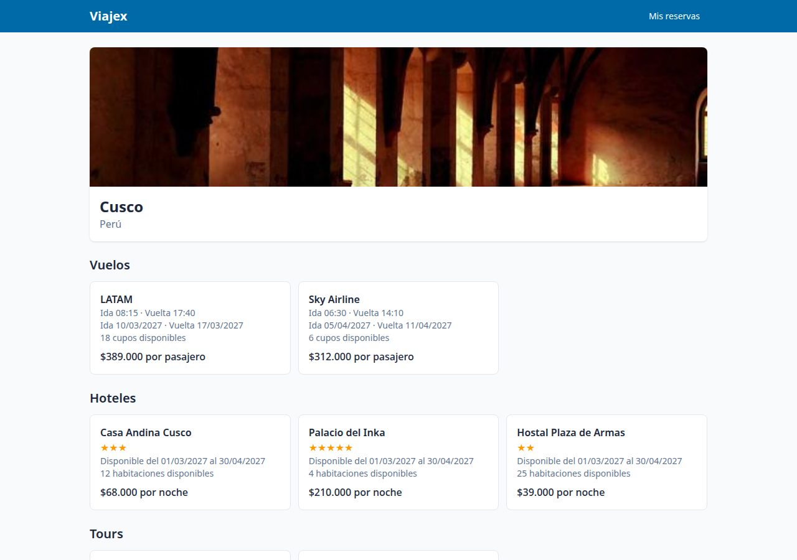
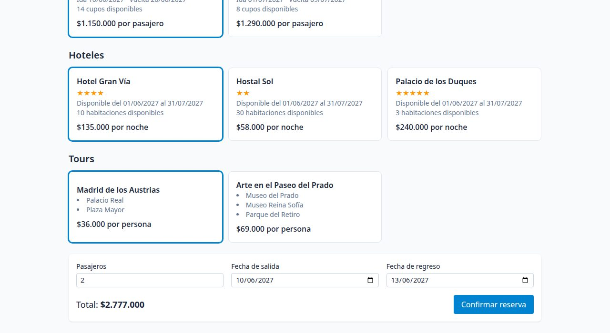
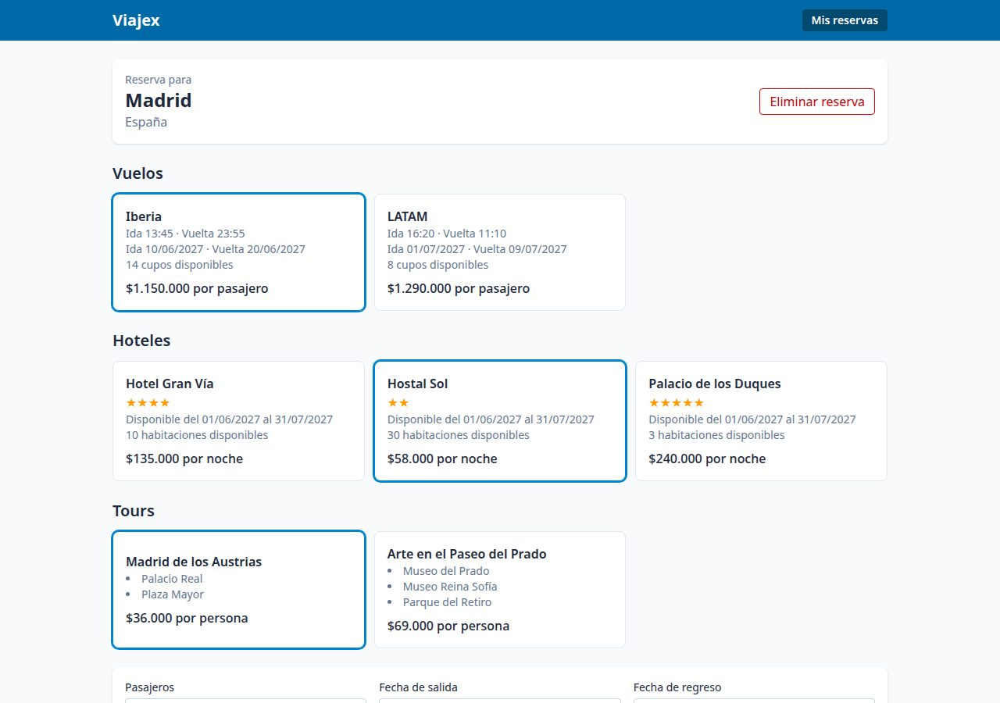
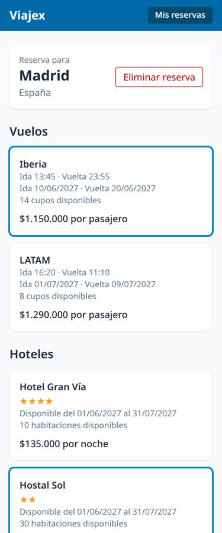

# Viajex

Demo académica de un sistema de reserva de vuelos, hoteles y tours, hecha con React. No tiene
servidor: una API **REST** (listado de destinos) y una API **GraphQL** (detalle y reservas) se
simulan dentro del navegador con Mock Service Worker, y las reservas se guardan en el
`localStorage`. Se desarrolló con Spec-Driven Development (Spec Kit).

**Demo publicada:** https://carlosjrf.github.io/viajex/

## Qué se puede hacer

- Explorar 5 destinos y ver sus vuelos (con fechas y cupos), hoteles (con rango de fechas y
  habitaciones) y tours con actividades.
- Armar una reserva con vuelo, hotel y/o tours, pasajeros y fechas; el total se calcula en vivo
  (`vuelo × pasajeros + hotel × noches + Σ tour × pasajeros`, en CLP). Al elegir un vuelo, sus
  fechas rellenan la reserva y se pueden editar. La disponibilidad es solo informativa.
- Ver, modificar (todo menos el destino) y eliminar las reservas guardadas en el navegador.

## Instalación y scripts

Requisitos: Node.js 20 o superior.

```bash
npm install --prefix client
npm run dev        # http://localhost:5173/
npm test           # pruebas de cálculo del total y validaciones (Vitest)
VITE_BASE_PATH=/viajex/ npm run build     # client/dist, con 404.html para las rutas internas
VITE_BASE_PATH=/viajex/ npm run preview   # http://localhost:4173/viajex/
```

`VITE_BASE_PATH` define la ruta base (por defecto `/`). La vista previa debe usar la misma base que
el build.

## Publicación

Cada push a `main` ejecuta [`.github/workflows/publicar.yml`](.github/workflows/publicar.yml):
instala, prueba, compila con la base `/viajex/` y sube `client/dist` a la rama `gh-pages`, desde
la que sirve GitHub Pages (Settings → Pages → Deploy from a branch → `gh-pages` / root).

## Estructura

```text
├── SDD/                                          # documentos SDD, juntos para auditarlos
│   ├── constitucion.md, spec.md, plan.md, tasks.md
│   └── research.md, data-model.md, quickstart.md, contracts/, checklists/
├── .github/workflows/publicar.yml
└── client/
    ├── public/mockServiceWorker.js               # service worker de MSW
    └── src/
        ├── mocks/        # API mock: catálogo, esquema, resolvers, persistencia, handlers, browser
        ├── lib/          # api (fetch), useConsulta, cálculos, validaciones, formatos
        ├── graphql/      # consultas y mutations como texto
        ├── components/   # tarjetas, selector de servicios, formulario, barra, mensajes
        └── pages/        # inicio, destino, reservas, reserva, no encontrada
```

## Trazabilidad SDD

Los documentos están en [`SDD/`](SDD/). Cada uno tiene su rama y cada versión es un commit:
`constitucion`, `spec`, `plan` y `tasks`. El código vive en `main`.

## Capturas

| Inicio | Destino |
|---|---|
|  |  |
| **Total en vivo** | **Modificar reserva** |
|  |  |

Vista móvil (375 px):



## Navegadores probados

Escenarios de [quickstart.md](SDD/quickstart.md) recorridos sobre la demo publicada.

| Navegador | Escenarios que pasan |
|---|---|
| Chrome (escritorio, 1280 px) | 1–5, 7–9, 11–17 y 20–26 (22 escenarios) |
| Firefox (escritorio) | 1–5, 7–9, 11–17, 20–24 y 26 (21 escenarios) |
| Móvil (emulación Chrome, 375 px) | 1–5, 7–9, 11–17 y 20–26 (22 escenarios) |

Al abrir directamente una ruta interna, la consola registra un 404: GitHub Pages responde
`404.html` (la app) con ese código. Es esperado.

Las pruebas se hicieron de forma automatizada (Puppeteer, fuera del proyecto) el 23/11/2026.
Corregido durante las pruebas: la vista previa local necesita `VITE_BASE_PATH` (quickstart, plan
v3.0.1).
